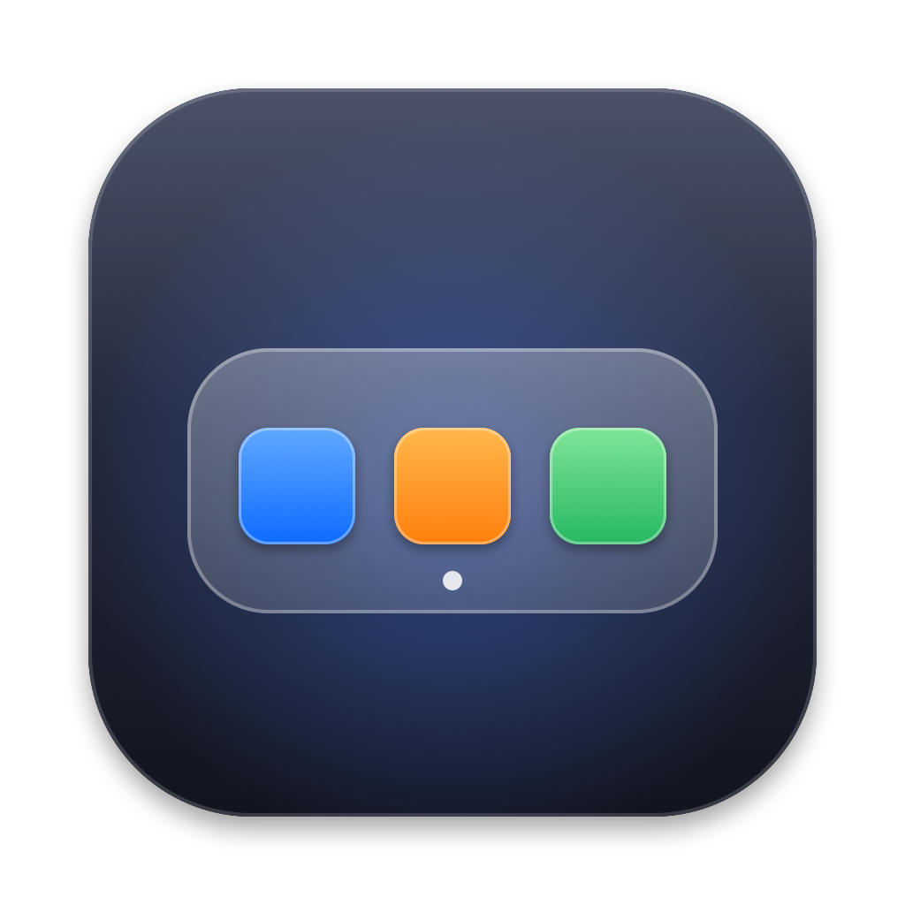
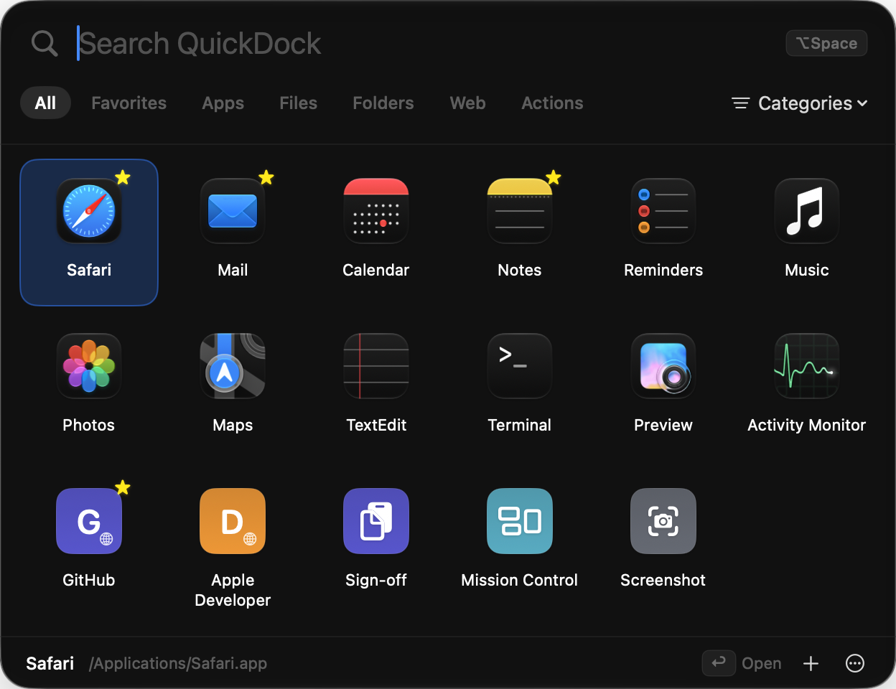
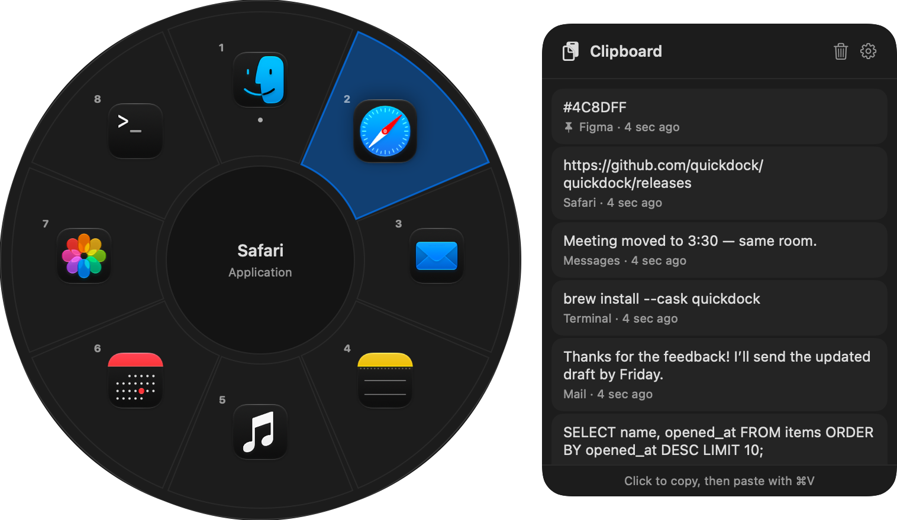

<p align="center">
  
</p>

<h1 align="center">QuickDock</h1>
<p align="center"><strong>Your Mac, one click away.</strong></p>

<p align="center">
A lightweight floating launcher for macOS. Keep the apps, files, folders, websites and
actions you use most one click (or <kbd>⌥ Space</kbd>) away. It's private, works offline and looks native.
</p>

<p align="center"></p>
<p align="center"></p>

> **Early access, unsigned build.** QuickDock 0.9.0 is **not** signed with an Apple Developer ID and
> **not** notarized by Apple. macOS will warn you the first time you open it. See [Installation](#installation).

## Features

- **Floating launcher.** A translucent panel (Liquid Glass on macOS 26+) appears on the display you're using, above your windows and over full-screen apps. Escape or a click outside closes it.
- **Quick Wheel.** Hold ⌥Tab: favorites and most-used apps appear in a ring around the pointer. Flick and release to open or switch, like a game's weapon wheel. Recent clipboard text sits beside it (opt-in, local only, password-manager copies skipped).
- **Menu bar and global shortcut.** Click the menu-bar icon or press ⌥Space, or any shortcut you record. QuickDock detects shortcut conflicts and falls back gracefully.
- **Apps, files, folders, websites and actions.** Actions include copying a text snippet, starting a new email, Mission Control, Screenshot, Screen Saver, System Settings and QuickDock Settings.
- **Organize.** Instant search, filters (All, Favorites, Apps, Files, Folders, Web, Actions), categories, favorites, custom names and icons, and drag-and-drop ordering.
- **Keyboard first.** Use the arrow keys and Return, ⌘Return (Show in Finder), ⌘1–⌘9, Tab (switch filter), ⌘E (edit), ⌘D (favorite) and Escape.
- **Resilient.** Moved files are followed. Missing files and uninstalled apps are flagged, with Locate… and Remove.
- **Your data.** Export and import configurations, restore file access, and reset.
- **Private.** Runs in the App Sandbox with **no network access**, no account, no analytics and no ads.

## Requirements

- macOS 13 Ventura or later
- Apple silicon Mac (arm64). The project is ready for a universal build later.

## Installation

1. Download `QuickDock-<version>-arm64.dmg` from the GitHub **Releases** page and, ideally, check its checksum:
   `shasum -a 256 ~/Downloads/QuickDock-0.9.0-arm64.dmg`
2. Open the DMG and drag **QuickDock** to **Applications**.
3. Open QuickDock. Because it isn't notarized, macOS blocks it the first time:
   - **macOS 15 Sequoia and later:** click **Done** in the warning, open **System Settings › Privacy & Security**, click **Open Anyway** next to QuickDock, and confirm.
   - **macOS 13–14:** Control-click QuickDock in Applications, choose **Open**, then click **Open**.

You only need to do this once. **Never disable Gatekeeper system-wide.** Full guide: [docs/INSTALL.md](docs/INSTALL.md).

## Uninstallation

Quit QuickDock (right-click the menu-bar icon › Quit) and drag it to the Trash. To also remove your items and
settings, delete `~/Library/Containers/io.github.sonal-jaiswal.QuickDock`. Or run `scripts/uninstall.sh`.
Details: [docs/UNINSTALL.md](docs/UNINSTALL.md).

## Building from source

Requires the Xcode Command Line Tools or Xcode 16+ (Xcode 26+ for Liquid Glass).

```sh
scripts/test.sh          # unit tests (Swift Testing)
scripts/build-app.sh     # Release build → build/QuickDock.app (ad-hoc signed)
scripts/make-dmg.sh      # → dist/QuickDock-<version>-arm64.dmg + .sha256
open build/QuickDock.app
```

To work in Xcode, open `Package.swift` (core library and tests) or generate the app project with
`brew install xcodegen && xcodegen generate` and open `QuickDock.xcodeproj`.

### Project layout

```
Sources/QuickDockCore/     Models, persistence, services (no UI) — fully unit-tested
  Models/                  LaunchItem, ItemTarget, KeyCombo, PredefinedAction, CustomIcon
  Persistence/             LibraryStore (atomic JSON + backup), AppPreferences, IconStore, ConfigurationTransfer
  Services/                LibraryManager, ItemResolver, ItemFactory, BookmarkService, ItemSearch
Sources/QuickDock/         The macOS app
  App/                     main, AppDelegate, AppEnvironment, WindowCoordinator, QAHarness (Debug only)
  Integrations/            LauncherPanel/Controller, StatusItem, HotKeyCenter (Carbon), ItemLauncher,
                           IconProvider, ItemAdder, SystemServices (login item, app info)
  Integrations/WheelController, ClipboardMonitor   Quick Wheel and opt-in clipboard history
  Views/                   Launcher, Wheel, Settings, Onboarding, Editor, Components
Tests/QuickDockCoreTests/  89 tests across 16 suites
Resources/                 Info.plist, entitlements, app icon
scripts/                   build, test, DMG, icon, uninstall, website release sync
website/                   Astro + Tailwind public website
docs/                      Install, uninstall, signing, donations, deployment, QA report
config/release.env         Bundle ID and public links (single source for the app build)
```

### Data and security

- Items are stored in `library.json` inside the sandbox container. Writes are atomic, and the previous good version is kept as `library.backup.json`. Unreadable files are set aside and never overwritten.
- Files and folders are opened through **security-scoped bookmarks** that are created only from user-chosen locations (the open panel, drag and drop, or Open With).
- QuickDock requests **no** Accessibility, Full Disk Access, Screen Recording, Automation or network entitlements, and never runs shell commands. Website items accept only `http(s)` addresses.
- Imported configurations are size-limited and fully re-validated. Foreign bookmarks are discarded.

## Releasing

1. Update `VERSION`, `CHANGELOG.md` and `MARKETING_VERSION` in `project.yml`.
2. Commit and push a tag: `git tag v0.9.0 && git push origin v0.9.0`.
3. `.github/workflows/release.yml` tests, builds, packages and publishes a GitHub Release (a prerelease while the version is 0.x).
4. Run `scripts/update-website-release.sh` and commit, so the website shows the new version, size and checksum.

Signing and notarization, once there's an Apple Developer account: [docs/SIGNING.md](docs/SIGNING.md).
Website deployment: [docs/DEPLOYMENT.md](docs/DEPLOYMENT.md). Donations setup: [docs/DONATIONS.md](docs/DONATIONS.md).

## Support the project

QuickDock is free and independent. Voluntary donations help fund the $99/year Apple Developer Program,
so that future releases can be signed and notarized.

**[♥ Sponsor QuickDock on GitHub](https://github.com/sponsors/Sonal-Jaiswal)**

## License

[MIT](LICENSE) © 2026 The QuickDock Authors. QuickDock is not affiliated with Apple Inc.
